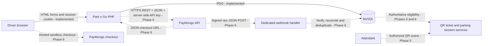

# CIT 305 integration preparation

Status: **Phase 2 preparation only. External integration pending Phase 6.** The existing native PHP application and Midnight Electric interface are preserved. Do not begin Phase 3 until the user confirms.

Subsequent update: the user confirmed Phase 3, which is now implemented and tested; see [Phase 3](../PHASE_3.md). The interface now uses Light Midnight Electric. The local availability JSON endpoint is an internal Park n Go interface, not PayMongo integration. The Phase 2 review below is retained as the original integration-preparation record.

Phase 4 update: [reservation checkout holds and conflict prevention](../PHASE_4.md) are implemented and tested after user authorization. Checkout creates only pending unpaid reservations, with no confirmation/payment/QR shortcut. This is still not the external PayMongo transaction required for CIT 305.

## Review of the existing project

Phase 1 already provides the public homepage, about/process pages, responsive navigation, server-side sample-facility search, and a client-side sample parking map. These remain unchanged.

Phase 2 already provides environment loading, PDO MySQL queries, migrations, development seeds, registration, password hashing/verification, login/logout, session expiry, driver/attendant/admin authorization, CSRF, throttling, profile edits, password recovery, audit events, and role landing pages. No account flow was recreated. The landing pages are not yet operational dashboards.

Review identified and fixed two Phase 2 reliability issues: logout previously needed a working database/audit insert, and failed session initialization/regeneration was not checked. Logout now clears authentication before attempting best-effort audit logging; its POST/CSRF checks remain mandatory. Session failures now fail closed with a generic error. Existing tests were adjusted to preserve throttle records and select the exact issued reset token rather than guessing by filename order.

The normal configured XAMPP database was unreachable during review. Read-only inspection of the existing isolated database confirmed all 18 expected tables and the original migration checksum. No original migration or existing schema was changed. New tests use a fresh separate database and leave older data intact.

## Database readiness

| Existing tables | Readiness and remaining implementation |
| --- | --- |
| `users`, `password_reset_tokens`, `rate_limits`, `audit_logs` | Used by working Phase 2 flows. |
| `parking_facilities`, `parking_floors`, `parking_slots`, `parking_rates` | Seeded sample inventory; public pages connect to these in Phase 3. |
| `reservations`, `reservation_holds` | Have ownership, time ranges, centavo estimates, rate snapshots, expiry, and overlap-query indexes. Row-lock conflict prevention belongs to Phase 4; indexes alone do not prevent overlap. |
| `parking_sessions`, `qr_tickets`, `qr_scan_logs` | Support reservation linkage, timestamps, token hashes, revocation/expiry, and scan logging. Phase 5 must add an explicit eligibility gate and decide how drivers securely reopen the same QR ticket; hashes cannot reconstruct original tokens. |
| `payment_transactions`, `payment_events`, `receipts` | Have exact centavo amounts, currency, status, sandbox flag, reservation linkage, idempotency keys, unique provider references/event IDs, and one receipt per transaction. Phase 6 must explicitly map checkout-session IDs separately from underlying payment IDs, adding a versioned migration if needed after validating the provider contract. No paid records are seeded. |
| `notifications`, `migrations` | Foundation for future notifications and tracked schema versions. |

## Two-system architecture

**System 1** is Park n Go (browser + native PHP + MySQL). **System 2** is PayMongo's hosted payment system. MySQL is an internal persistence component, not the second external system for CIT 305.

Dashed paths below are planned; they do not represent existing integration.

## Prepared module boundaries

- `config/payments.php`: private PayMongo configuration; `enabled=false` and `implementation_status=pending_phase_6`. Blank keys are allowed. No configuration can switch on unimplemented processing.
- `app/services/Api/Json.php`: strict, offline JSON object encoding/decoding with size/depth limits and exceptions. This is tested utility code, not evidence of external REST exchange.
- `app/services/Api/`: future official HTTPS transport and provider adapter.
- `app/services/Payments/`: future checkout orchestration, verification, event deduplication, reconciliation, transaction records, and receipts.
- `app/controllers/Api/`: future JSON controllers and raw-body webhook ingress. No route is currently registered.
- `app/services/Qr/`: future secure QR issuance and payment/reservation eligibility checks.
- `app/services/Parking/`: future authoritative entry/exit session operations.

Only README contracts are present for the pending modules. There are no stub payment-success functions or fake checkout buttons.

## Credentials and official provider contract

`.env.example` reserves `PAYMONGO_SECRET_KEY` and `PAYMONGO_WEBHOOK_SECRET`, both empty. Existing `.env` files do not need keys in Phase 2. Keep secrets server-side, out of public files, screenshots, version control, request logs, and Postman exports. `PAYMENT_MODE=sandbox` remains the intended development mode. Do not accept live keys/events during the future sandbox demonstration.

At review time, the official [Hosted Checkout quick start](https://docs.paymongo.com/docs/payment-channels-hosted-checkout-quick-start) describes server-side `POST https://api.paymongo.com/v2/checkout_sessions` using HTTP Basic authentication with the secret key as username and an empty password; requests and responses use JSON. Park n Go's future adapter will obtain the hosted checkout URL from the response. Reconfirm the API version and account-enabled payment methods during Phase 6, rather than assuming all wallets/cards are enabled. No actual request or provider response has been captured yet.

PayMongo documents a `Paymongo-Signature` header and HMAC-SHA256 over timestamp plus the **original raw body**, with different signature fields for test and live events. See [official webhook security documentation](https://docs.paymongo.com/docs/developer-tools-webhook-setup-management). The planned handler must check the test signature, timestamp freshness, event mode, provider ID, amount/currency, reservation mapping, and duplicate event IDs before committing verified payment state. Signature verification is pending, not provided by the JSON codec.

## Planned complete transaction — pending

1. Authenticated driver creates an eligible reservation and time-limited hold (Phase 4).
2. PHP derives the total from authoritative rates and reservation data, then records a pending sandbox payment transaction.
3. PHP sends a JSON request to the official PayMongo checkout API using the test secret; records the returned identifiers; sends the driver to the hosted checkout URL.
4. The driver completes a sandbox payment on PayMongo. Card/PIN data never passes through Park n Go.
5. PayMongo sends a signed JSON webhook to a reachable HTTPS endpoint. The handler verifies the raw body and reconciles the provider payment with the internal pending transaction.
6. A database transaction deduplicates the event, updates payment/reservation state, and issues exactly one digital receipt. Invalid, delayed, duplicate, or unmatched events cannot bypass policy. A paid notification arriving after a hold expires must not steal a slot already allocated to another driver; define a reconciliation/refund workflow during Phase 6.
7. QR issuance checks authoritative payment and reservation eligibility. **Phase 5 must keep real prepaid issuance blocked until Phase 6 verification exists.** Test fixtures must be clearly isolated and labeled; they are not real payments or integration evidence.
8. Authorized attendant scans start/end a parking session. Additional charges are settled through the same verified payment boundary before exit when required.

A browser success redirect alone never changes payment state, issues a receipt, or unlocks a QR ticket.

## CIT 305 requirement and evidence register

| Requirement | Current status | Evidence needed for final submission |
| --- | --- | --- |
| Two integrated systems | Systems identified; connection pending | Park n Go reservation correlated to an actual PayMongo sandbox session/payment. |
| REST communication | Pending Phase 6 | Real sanitized HTTP method, endpoint, status, and timestamp. |
| JSON exchange | Offline codec tested; provider exchange pending | Sanitized actual request, actual provider response, and actual signed notification. |
| API requests and responses | Pending | Recorded provider request/response pair with correlation IDs. |
| API authentication | Empty environment placeholders prepared | Demonstration using a secret test key; show only redacted headers. |
| Complete transaction | Pending | Reservation → checkout → verified webhook → receipt → eligible QR ticket. |
| Architecture diagram | Prepared above | Update diagram to reflect final implemented paths. |
| At least five integration cases | Planned below | Executed results with assertions and provider IDs. |
| Postman or equivalent evidence | Local account HTTP tests exist; provider testing pending | Sanitized Postman collection/run or equivalent cURL/PHP HTTP evidence against the actual PayMongo sandbox. Local account tests do not meet this provider evidence requirement. |
| Complete documentation | Preparation document exists | Final setup, contracts, mappings, failure/retry/security handling, results, and operational limitations. |

## Integration test plan — not executed

| ID | Scenario | Expected assertion/evidence |
| --- | --- | --- |
| INT-01 | Valid official sandbox checkout request | Provider returns checkout session/URL; local payment stays pending until verified. Save sanitized JSON and session ID. |
| INT-02 | Missing/invalid API credential | Provider rejects authentication; no paid state, receipt, or QR. Save actual error status/body without secrets. |
| INT-03 | Successful hosted sandbox payment and authentic webhook | Correct mode/amount/currency/IDs map to one local transaction, receipt, and eligible ticket. Correlate provider event and database IDs. |
| INT-04 | Missing/invalid signature or modified JSON body | Reject notification; no financial or QR side effects. Save actual test response and unchanged-record assertion. |
| INT-05 | Redelivery of the same genuine notification | One applied financial transition and one receipt; event uniqueness prevents duplicate processing. |
| INT-06 | User manually visits success URL | Payment remains pending; QR remains blocked. |
| INT-07 | Provider payment amount, currency, or mode differs | Do not apply the event to the reservation; record a safe reconciliation outcome. |
| INT-08 | Checkout cancelled, abandoned, or API times out | No fake success; preserve pending/failed/cancelled semantics and handle hold expiry safely. |
| INT-09 | Real paid notification arrives after hold expiry | No double booking; apply the documented reconciliation/refund policy. |
| INT-10 | Additional-session-fee payment | Outstanding balance changes only after verified payment; attendant exit remains blocked until policy is satisfied. |

## Postman/equivalent evidence procedure — Phase 8

Use local Postman variables for the sandbox key, never a shared/exported initial value. Add provider create/retrieve checkout requests and the future application's verification endpoints only after Phase 6 implements them. Use actual PayMongo test-mode delivery for the signed-success evidence; hand-written payloads are only negative/fixture cases, not proof of provider integration. Export redacted collection/run results and sanitized request/response JSON with timestamps and consistent IDs. Document that monetary amounts are sandbox values.

No success screenshot, sample provider JSON, or fabricated run report is included as completed evidence in Phase 2.

## Phase sequence and current handoff

User-authorized Phases 2–4 are complete. The next implementation phase is payment-gated QR/scans/sessions (5), followed by PayMongo REST/JSON/sandbox/webhooks/receipts (6), operations dashboards (7), and integration/Postman/security/deployment evidence (8). The current task ends at the Phase 4 handoff.
